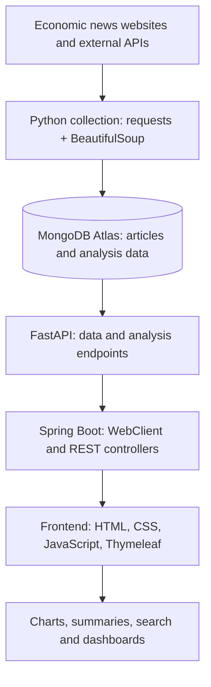

# SUMMARIX — AI-Powered Economic News Analysis

**A five-person team project turning economic news and YouTube discussions into accessible, visual insights.**

**Project period:** September–October 2025  
**My role:** News crawling, news summarisation, YouTube opinion mining, and API/data integration  
**Type:** Software development bootcamp team capstone

[Watch the demo](https://www.youtube.com/watch?v=Bk_dYeuUDCE) · [Original team repository](https://github.com/yooseungmin9/dgict-teamb) · [My API integration commit](https://github.com/yooseungmin9/dgict-teamb/commit/9149bc578f1225736668d12ebc05f8832da4a9e4)

> **Portfolio note:** This repository is an English-language case study of my contributions to a collaborative project. The original source code remains in the team repository. This portfolio is **documentation-only**, not a standalone runnable application.

## Project overview

SUMMARIX is an AI-assisted economic news analysis web application created during a software development bootcamp in South Korea. The team combined external news and video data, unstructured-data storage, natural-language processing, API services, and interactive dashboards to make economic trends easier to understand.

### Team-developed features

- Economic news dashboard with headlines, keyword rankings, trends, sentiment indicators, and topic clusters
- Daily article summaries and news briefings
- YouTube comment analysis, including sentiment and keyword visualisations
- News search, content recommendations, and an AI-powered chatbot

These were **team features**, not features I built entirely on my own.

## My contributions

### 1. Python web crawling and data storage

- Developed Python web-crawling scripts using **requests** and **BeautifulSoup** to collect and parse Korean economic news articles.
- Processed unstructured article content and stored records in **MongoDB** for subsequent analysis.
- Worked on data preparation to support news categorisation, summarisation, keywords, and sentiment analysis.

### 2. FastAPI ↔ Spring Boot ↔ frontend integration

- Built a **FastAPI** endpoint that retrieved MongoDB-backed news data and returned keyword-trend information as **JSON**.
- Implemented a proof-of-concept **Spring Boot** controller using **WebClient** to fetch data from FastAPI.
- Connected the response to a webpage using JavaScript **fetch()** and **Chart.js** to visualise keyword trends.

**Evidence:** [My MongoDB → FastAPI → Spring Boot → Chart.js integration commit](https://github.com/yooseungmin9/dgict-teamb/commit/9149bc578f1225736668d12ebc05f8832da4a9e4).

### 3. News summaries and opinion mining

- Contributed to news summarisation workflows and API-connected news presentation.
- Worked on YouTube opinion-mining functionality, including Korean text tokenisation and stopword filtering.
- Investigated data flow and frontend display issues while integrating features with the rest of the team.

The original team's [README](https://github.com/yooseungmin9/dgict-teamb/blob/main/README.md) lists my responsibilities under **장성진**.

## System architecture

The application's main web layer used **Spring Boot (Java)**, while Python-based analysis and data functionality were exposed through **FastAPI**. **MongoDB Atlas** was used for storage.

*This diagram illustrates a representative data flow. Other application features used additional services and integrations.*

### Example: keyword-trend visualisation

1. News data was collected and stored in MongoDB.
2. A FastAPI endpoint retrieved relevant documents and returned processed keyword data as JSON.
3. Spring Boot used WebClient to request that API response.
4. The frontend retrieved the response using JavaScript and visualised the data with Chart.js.

This particular end-to-end integration was a **prototype**, not a claim of production deployment.

## Technology stack

| Area | Technologies in the team project |
| --- | --- |
| Frontend | HTML, CSS, JavaScript, Thymeleaf, Chart.js |
| Web backend | Java 17, Spring Boot, Gradle, Spring WebClient |
| Python API and processing | Python, FastAPI, pandas, requests |
| Collection | BeautifulSoup, external news APIs, YouTube Data API |
| Database | MongoDB Atlas |
| AI and NLP | Korean text processing, sentiment analysis, summarisation, topic clustering, LLM-based features |
| Version control | Git, GitHub |

**My primary hands-on work:** Python, BeautifulSoup, MongoDB, FastAPI, REST/JSON integration, a Spring Boot WebClient proof of concept, and JavaScript/Chart.js data rendering.

## What I learned

- Building data pipelines for unstructured web content
- Retrieving database records through REST API endpoints
- Connecting independently developed backend services to a browser UI
- Debugging problems across collection, data storage, APIs, and rendering
- Collaborating on a multi-module web application with a five-person team

## Demo and source-code evidence

- **Demo video:** https://www.youtube.com/watch?v=Bk_dYeuUDCE
- **Original team source:** https://github.com/yooseungmin9/dgict-teamb
- **My API integration commit:** https://github.com/yooseungmin9/dgict-teamb/commit/9149bc578f1225736668d12ebc05f8832da4a9e4
- **Team role allocation:** https://github.com/yooseungmin9/dgict-teamb/blob/main/README.md

## Credits and scope

**SUMMARIX was developed by five team members.** This README distinguishes my individual contributions from features implemented by teammates. It does not reproduce the original source files or any application credentials.

---

**Seongjin Jang** · [LinkedIn](https://www.linkedin.com/in/seongjin-jang-87815b359)
